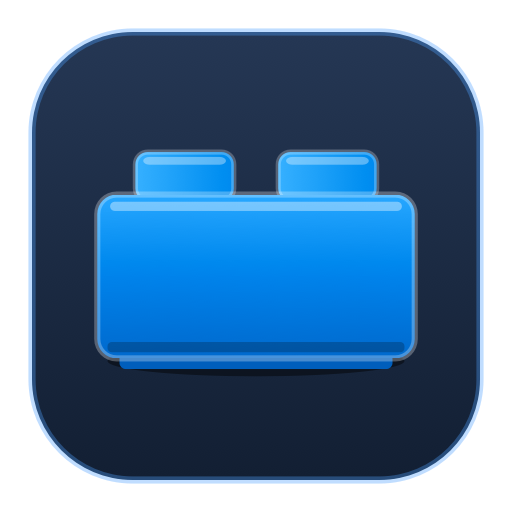
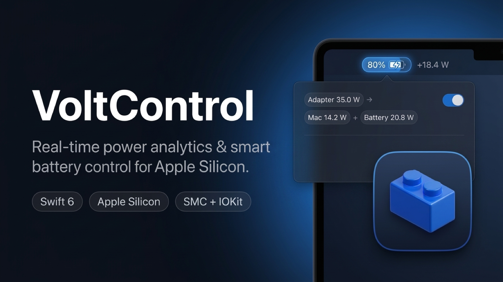

<p align="center">
  
</p>

<h1 align="center">⚡ VoltControl</h1>

<p align="center">
  <b>Lightweight, native macOS Menu Bar utility for real-time power analytics, smart battery charging control, and process energy monitoring on Apple Silicon MacBooks.</b>
</p>

<p align="center">
  <a href="https://github.com/banzaez/volt-control/releases/latest"></a>
  
  
  
  
</p>

<p align="center">
  
</p>

<p align="center">
  <a href="#-overview">Overview</a> •
  <a href="#-core-features">Core Features</a> •
  <a href="#-engineering--architecture">Engineering & Architecture</a> •
  <a href="#-configuration-guide">Configuration Guide</a> •
  <a href="#-installation">Installation</a> •
  <a href="#-building">Building</a>
</p>

---

## 📖 Overview

MacBook lithium-ion cells experience accelerated chemical aging when continuously kept at 100% capacity under sustained charging voltage and elevated operating temperatures.

**VoltControl** is engineered specifically for **Apple Silicon (`arm64`)** MacBooks using Swift 6, SwiftUI, AppKit, and IOKit:
1. **Real-time power flow tracking**: Watt-level monitoring across DC adapter input, internal battery charging/discharging, and Mac system load.
2. **Proactive charging thresholds**: Custom charge limits (`min(appLimit, macOSLimit)`), hysteresis-based Sailing Mode, and thermal safeguards with a 2°C hysteresis band.
3. **Stabilized process monitoring**: A fixed 3-slot energy consumer panel aggregated by full process tree (`PID`/`PPID`) to eliminate popover flickering and height jumping.
4. **Secure privilege separation**: `SMAppService.daemon` + XPC (`com.voltcontrol.helper`) with code-signing verification and automatic safety fail-safes.
5. **Automatic updates**: Built-in Sparkle 2 updater with Ed25519 signature verification.

---

## 🚀 Core Features

### ⚡ Real-Time Power Telemetry
Unlike conventional battery utilities that only display percentage increments, VoltControl reads live wattage directly from hardware sensors:

| Metric | Source Sensor | Description |
| :--- | :--- | :--- |
| **Adapter Input** | `PDTR` (SMC) / `PowerTelemetryData` | Total DC-In power arriving from USB-C or MagSafe chargers. |
| **Battery Power** | `SBAP` (SMC) / `AppleSmartBattery` | Signed wattage flow: `+W` when replenishing, `-W` during discharge. |
| **System Load** | `PSTR` (SMC) / Computed Balance | Net real-time power consumed by the SoC, display, and peripherals. |
| **Split Balance** | Real-time Ratio | Proportional balance bar showing how incoming power splits between system and cells. |

### 🛡️ Smart Charging Protection
- **Target Limiting (50% – 100%)**: Set custom stopping limits (recommended 80%) to minimize cell voltage stress. Respects native macOS Battery limit (`pmset -g battlimit`) via `min(appLimit, systemLimit)`.
- **Sailing Mode (Hysteresis)**: Allows charge to naturally settle within a customizable delta (e.g., 4%) before topping back up, avoiding harmful micro-cycles.
- **One-Click Top Up**: Rapidly charges to 100% on demand prior to mobile sessions, then automatically restores your previous limit.
- **Thermal Safety Cutoff**: Suspends charging automatically when pack thermals exceed a configured threshold (32°C to 45°C) with 2°C hysteresis recovery.
- **Direct Battery Mode**: Temporarily disconnect adapter power delivery to run on internal battery while physically connected to AC (with automatic 10% floor protection).

### 📊 Stable Energy Impact Panel
- **Zero-Jitter Fixed Layout**: The process monitor occupies an exact 76 pt vertical frame, ensuring popover menus never resize or jump during background scans.
- **Process Tree Aggregation**: Sums CPU usage across each app's full `PID`/`PPID` hierarchy without fragile name-prefix heuristics.
- **Adjustable Sensitivity**: Fine-tune custom thresholds for *High* and *Very High* consumption categories, toggle system processes, or define an ignore list.

### 🎨 Menu Bar Customization
- **Icon Styles**: Capsule Pill, Classic Battery, or Minimal Symbol.
- **Status Readouts**: Icon only, percentage, signed wattage (`+24,5 Вт` / `-5,6 Вт`), or pack temperature.
- **Colorized Accents**: Optional native green/blue/red state highlights or clean monochrome.

---

## 🔬 Engineering & Architecture

### Modular Architecture (`VoltCore` + `VoltControl` + `VoltControlHelper`)
- **`VoltCore`**: Shared Swift 6 module containing `SMCConnection` (cached key info, thread-safe `NSLock`, zero-reflection byte reads), `ChargeHardware` capability probing, `ChargeMode`, and `VoltHelperProtocol` XPC interface.
- **Pure Telemetry & Policy**: `BatteryTelemetryParser` and `ChargePolicy` are pure, unit-tested components decoupled from UI and IOKit side effects.
- **Privileged Daemon (`SMAppService.daemon`)**:
  - Communicates over Mach XPC (`com.voltcontrol.helper`) with `setCodeSigningRequirement` validation.
  - Restores `.normal` charging & adapter state on startup, on XPC disconnect/crash, and via a 60s discharge floor watchdog (≤ 10%).
  - Automatically cleans up any legacy `PrivilegedHelperTools` binary on startup.

```
┌─────────────────────────────────┐
│     AppleSmartBattery (IOKit)   │───► [IOPSNotification Source] ───► Instant AC State
└─────────────────────────────────┘
┌─────────────────────────────────┐
│        AppleSMC (Read-Only)     │───► [PDTR / SBAP / PSTR / TB0T] ─► Live Power & Temp
└─────────────────────────────────┘
┌─────────────────────────────────┐
│   VoltControlHelper (launchd)   │◄═══ [XPC + CodeSign Check] ══════► ChargeController
└─────────────────────────────────┘
```

---

## ⚙️ Configuration Guide

The Settings window (`⌘,`) organizes configuration into dedicated sections:

1. **General**: Launch at login (`SMAppService.mainApp`), automatic Sparkle updates, sensor polling interval (1–10s), popover action behavior.
2. **Charging**: Target charge limit slider, native macOS limit indicator, sailing delta, thermal cutoff controls.
3. **Energy**: CPU threshold sliders, system process inclusion, moderate/low consumption toggles, ignore list.
4. **Menu**: Toggle individual popover sections and telemetry rows.
5. **Icon**: Menu bar icon style, readout format, colorized accents.
6. **Diagnostics**: Live cell health, cycle count, pack temperature, voltage, amperage, and watt balance.
7. **Notifications**: Limit reached, 100% top-up completion, thermal warning, and low-battery alerts.
8. **SMC Controller**: Daemon status (`SMAppService`), detected hardware capabilities, live SMC key diagnostics, and install/uninstall controls.
9. **About**: Version info, Sparkle manual update check, and architecture overview.

---

## 📦 Installation

### Prebuilt Binary

1. Download **`VoltControl-v1.1.0-macOS.zip`** from [GitHub Releases](https://github.com/banzaez/volt-control/releases/latest).
2. Decompress the archive and move **`VoltControl.app`** to `/Applications`.
3. Open **VoltControl** from `/Applications`.
4. To enable hardware SMC control, click **«Включить»** in the popover (or Settings → SMC) and allow **VoltControl** in **System Settings → General → Login Items**.

---

## 🛠 Building

### Requirements
- Apple Silicon Mac (M-series, `arm64`)
- macOS 14.0 (Sonoma) or later
- Swift 6.0+ toolchain / Xcode 15.0+

### Privileged Daemon & Code Signing
- `./build_app.sh` compiles `arm64` release binaries, embeds `VoltControlHelper`, `Contents/Library/LaunchDaemons/com.voltcontrol.helper.plist`, and `Sparkle.framework`, renders `AppIcon.icns`, and signs inside-out with `Developer ID Application` or `Apple Development` (or `SIGN_IDENTITY` env var).
- Note: Ad-hoc signing (`-`) does not support `SMAppService.daemon` Team ID validation.

```bash
# Clone repository
git clone https://github.com/banzaez/volt-control.git
cd volt-control

# Run tests
swift test

# Build signed arm64 .app bundle
./build_app.sh

# Run
open VoltControl.app
```
